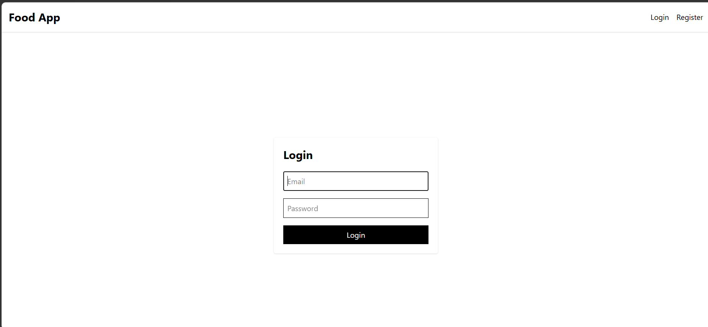
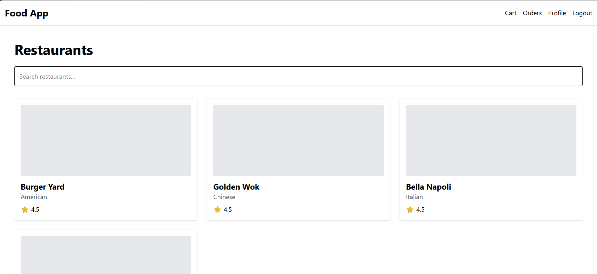
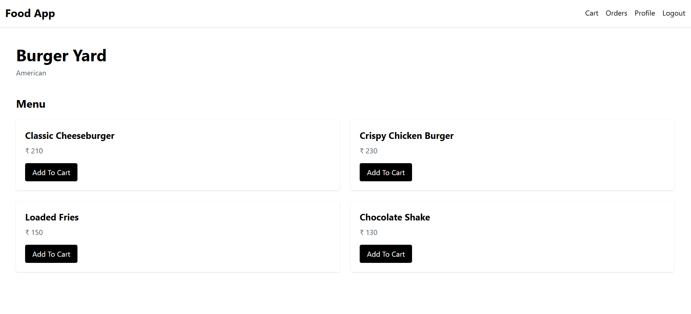
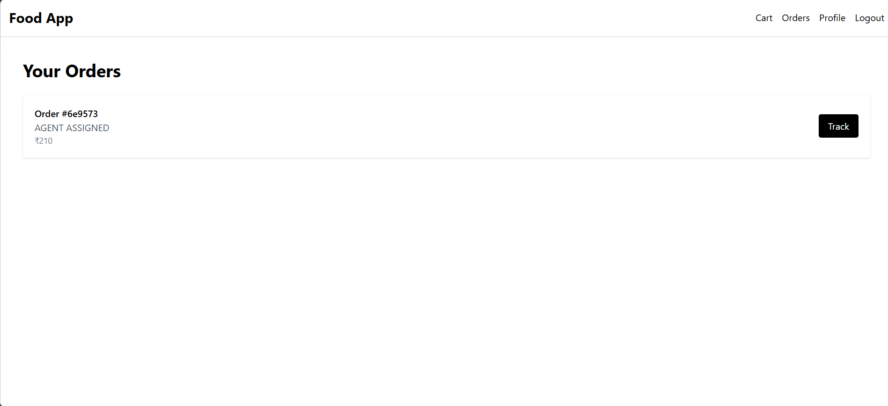
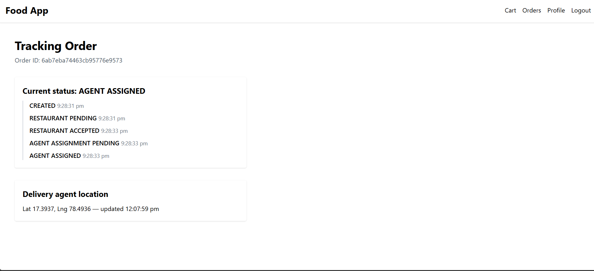

# Food Delivery Backend — Microservices Architecture

A food delivery platform built with **Node.js, Express.js, MongoDB, Kafka, Redis, Socket.IO, and Docker Compose**. The system separates core responsibilities into independent services and supports order processing, restaurant decisions, agent assignment, and real-time delivery tracking.

## Screenshots

### Login


### Home


### Restaurant Menu


### Orders


### Live Order Tracking


## Architecture

- **API Gateway:** Routes requests to backend services, handles authentication, applies rate limiting, and relays real-time updates.
- **User Service:** Manages registration, login, and user profiles.
- **Restaurant Service:** Manages restaurants, menus, and restaurant-side order operations.
- **Order Service:** Creates orders, validates prices, manages order status transitions, and coordinates order events.
- **Agent Service:** Manages delivery agents, location updates, and agent assignment.
- **Notification Service:** Processes events for order-related notifications.
- **Apache Kafka:** Enables asynchronous communication between services.
- **Redis:** Supports geospatial agent discovery, atomic agent reservation, caching, and real-time location distribution.
- **MongoDB:** Stores application data.
- **Socket.IO:** Provides authenticated, real-time order tracking.

## Key Features

- Microservices-based backend architecture.
- JWT authentication and protected endpoints.
- Restaurant menu and order management.
- Server-side price validation during order creation.
- Order creation idempotency using an idempotency key and a unique database index.
- Event-driven communication using Kafka.
- Transactional outbox pattern for reliable event publication.
- Idempotent Kafka consumers to reduce duplicate processing.
- Retry mechanisms and dead-letter queues (DLQs).
- Saga-style coordination with compensating actions for failures.
- Redis GEO for finding nearby delivery agents.
- Redis Lua scripts for atomic agent reservation.
- Agent location updates and real-time order tracking using Socket.IO.
- Docker Compose for running the application infrastructure and services.

## Order Lifecycle

1. A customer creates an order through the API Gateway.
2. The Order Service validates the request and calculates prices on the server.
3. The order and its outbox event are written atomically.
4. The outbox relay publishes the event to Kafka.
5. The Restaurant Service processes the order and accepts or rejects it.
6. When accepted, the Agent Service searches for a nearby available agent and attempts to reserve one.
7. Order status and assignment events are communicated through Kafka.
8. The customer receives real-time tracking updates through Socket.IO.
9. If the restaurant rejects the order or no agent is available, the Order Service can cancel the order through a compensating action.

## Reliability and Failure Handling

### Transactional Outbox

The Order Service records state changes and corresponding events in the same atomic MongoDB document update. A relay publishes pending events to Kafka and retries failures, marking events as failed after five attempts.

If Kafka publication succeeds but the relay crashes before marking an event as sent, the event may be published again. Idempotent consumers help prevent duplicate business processing.

### Consumer Retries and Dead-Letter Queues

Kafka consumers use idempotency checks and retry failed processing. After three failed attempts, an event is sent to the corresponding dead-letter topic, named using the original topic plus `.dlq`.

Dead-letter queues preserve failed events for later investigation; they do not automatically guarantee successful reprocessing.

### Agent Assignment

Redis GEO helps identify nearby agents. A Redis Lua script performs the availability check and reservation atomically, reducing the risk of assigning the same agent to multiple orders concurrently.

### Order Creation Idempotency

An idempotency key, scoped to the user through a unique compound index, helps prevent duplicate orders when the same logical request is submitted more than once.

## Technology Stack

| Area | Technologies |
|---|---|
| Backend | Node.js, Express.js |
| Database | MongoDB, Mongoose |
| Messaging | Apache Kafka |
| Caching and geospatial search | Redis |
| Real-time communication | Socket.IO |
| Authentication | JWT |
| API Gateway | Express, HTTP proxy middleware |
| Infrastructure | Docker, Docker Compose |
| Testing | Automated service tests, manual API checks |

## Getting Started

### Prerequisites

- Node.js and npm
- Docker and Docker Compose
- Git

### 1. Clone the repository

```bash
git clone https://github.com/BhaskarManikanta/FoodDelivery_Backend.git
cd FoodDelivery_Backend
```

### 2. Configure environment variables

Create the required `.env` files for the services using the repository's environment configuration and documentation.

Configure MongoDB, Redis, Kafka, JWT secrets, service URLs, and the shared `INTERNAL_SERVICE_SECRET` as required. Internal services must use the same configured secret.

Do not commit real credentials or production secrets.

### 3. Start the application

Use the Docker Compose configuration provided by the repository:

```bash
docker compose up --build
```

If the project requires database initialization, run its seed script according to the repository instructions after configuring the environment.

### 4. Seed demo data

The repository includes a seed-all script that creates demo data, including a restaurant and an available delivery agent.

Use the documented seed command and ensure the required services and databases are running before executing it.

### Demo Accounts

The seed configuration provides these demo accounts:

| Role | Email | Password |
|---|---|---|
| Customer | `customer@example.com` | `password123` |
| Restaurant | `restaurant@example.com` | `password123` |
| Delivery Agent | `agent@example.com` | `password123` |

These credentials are for local development and testing only.

## API Overview

All client-facing endpoints are accessed through the API Gateway.

### Authentication

| Method | Endpoint | Purpose |
|---|---|---|
| POST | `/api/users/register` | Register a user |
| POST | `/api/users/login` | Authenticate a user |
| GET | `/api/users/profile` | Get the authenticated user's profile |

### Restaurants

| Method | Endpoint | Purpose |
|---|---|---|
| GET | `/api/restaurants` | List restaurants |
| GET | `/api/restaurants/search?q=` | Search restaurants |
| GET | `/api/restaurants/:id` | Get restaurant details |
| GET | `/api/restaurants/mine` | Get the restaurant user's restaurant |
| POST | `/api/restaurants` | Create a restaurant |
| PATCH | `/api/restaurants/:id` | Update a restaurant |
| DELETE | `/api/restaurants/:id` | Delete a restaurant |

### Orders

| Method | Endpoint | Purpose |
|---|---|---|
| POST | `/api/orders` | Create an order |
| GET | `/api/orders/my-orders` | List customer orders |
| GET | `/api/orders/restaurant/mine` | List restaurant orders |
| GET | `/api/orders/agent/mine` | List agent orders |
| GET | `/api/orders/:id` | Get order details |
| PATCH | `/api/orders/:id/status` | Update order status |
| PATCH | `/api/orders/:id/cancel` | Cancel an order |

### Delivery Agents

| Method | Endpoint | Purpose |
|---|---|---|
| PUT | `/api/agents/profile` | Create or update agent profile |
| GET | `/api/agents/profile/me` | Get agent profile |
| PATCH | `/api/agents/status` | Update agent availability |
| PATCH | `/api/agents/location` | Update agent location |

Some endpoints require specific roles or internal-service authentication. Consult the service routes for exact request bodies, validation rules, and authorization requirements.

## Kafka Events

The application uses Kafka topics to coordinate asynchronous workflows. Topics include:

- `order-created`
- `restaurant-accepted`
- `restaurant-rejected`
- `agent-assigned`
- `no-agent-available`
- `order-picked-up`
- `out-for-delivery`
- `order-delivered`
- `delivery-failed`
- `order-cancelled`

Corresponding dead-letter topics use the `.dlq` suffix.

## Testing

The repository contains automated tests for the following services:

- **User Service:** 5 tests
- **Order Service:** 16 tests
- **Agent Service:** 5 tests

The Agent Service tests require Redis to be available. The Restaurant Service and Notification Service do not currently have automated test suites documented here. API Gateway proxy behavior has been checked manually.

Run each service's test command from its directory, using the scripts defined in that service's `package.json`. Ensure required environment variables and dependencies are configured before running tests.

## Security Considerations

- Protect private endpoints with authentication and authorization.
- Use the shared internal-service secret only for trusted service-to-service communication.
- Keep JWT secrets and database credentials out of source control.
- Validate all incoming request data.
- Do not trust client-submitted prices or unauthorized order-status changes.
- Use the seeded credentials only in local development.

## Current Scope and Limitations

## Current Scope and Limitations

- **Restaurant Order Decisions:** Restaurant order acceptance and rejection are currently handled automatically. A complete restaurant-facing workflow for manually reviewing, accepting, or rejecting incoming orders is not yet implemented.
- **Automated Test Coverage:** Test coverage varies by service. The Restaurant Service and Notification Service do not currently have automated test suites documented in the repository.
- **Payment Processing:** Payment gateway integration, payment verification, refunds, and payment reconciliation are not yet implemented.
- **Notifications:** The Notification Service processes order-related events, but additional delivery channels such as email, SMS, and push notifications may require further implementation.
- **Delivery Tracking:** Real-time agent location updates and order tracking are supported, but advanced features such as route visualization and estimated arrival times are not yet implemented.
- **Deployment and Scaling:** The application supports Docker Compose for local development. Production-grade orchestration, independent service scaling, and comprehensive deployment automation remain future improvements.
- **Distributed Processing:** The system uses event-driven communication, an outbox pattern, and idempotent consumers to improve reliability. These mechanisms do not guarantee exactly-once processing across the entire distributed workflow.
- **API Documentation:** Interactive API documentation using Swagger/OpenAPI is a planned improvement.

These limitations describe the current project scope and identify areas for future development.

## Author

**Bhaskar Manikanta**

GitHub: [BhaskarManikanta](https://github.com/BhaskarManikanta)
