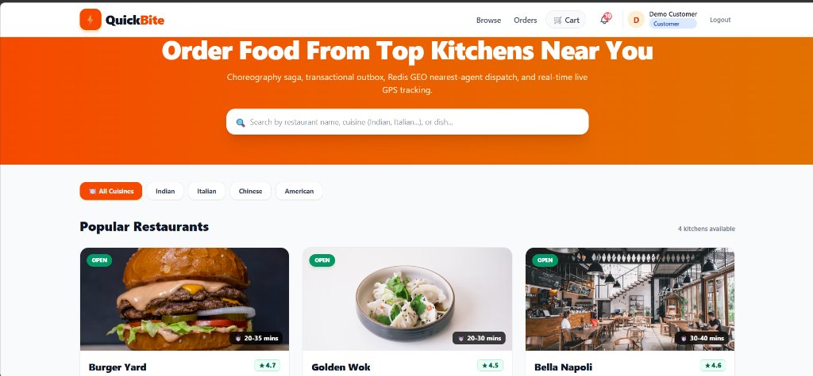
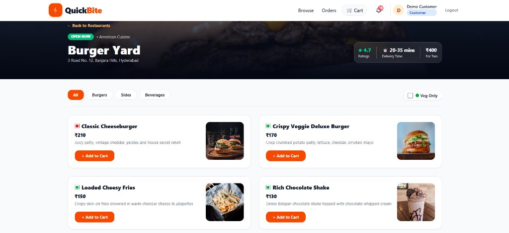
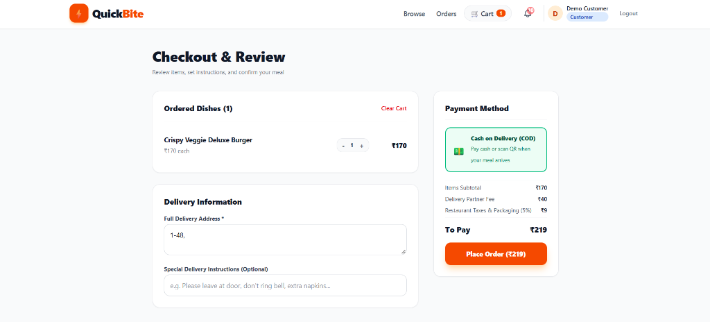
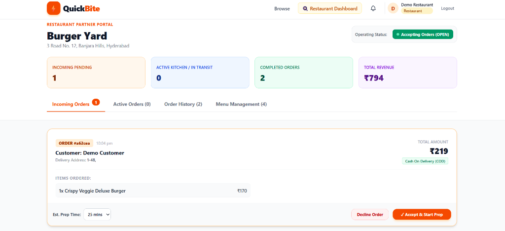
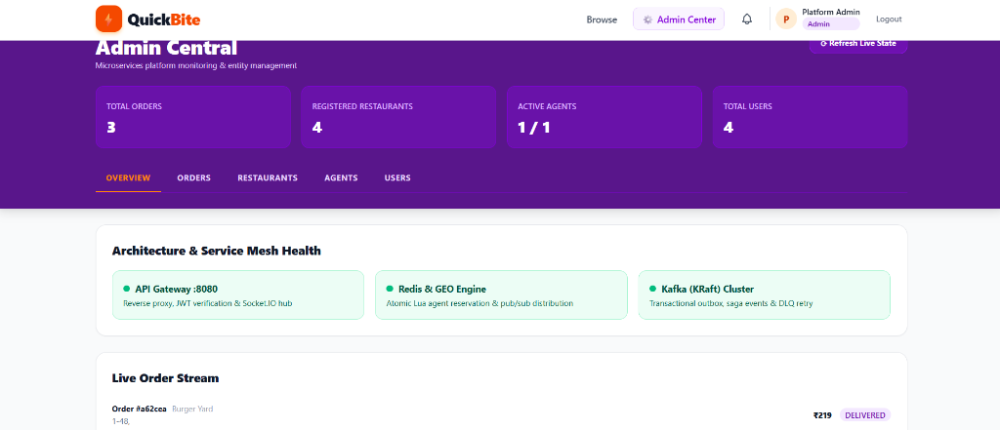

# Food Delivery Microservices Platform

> Demo video: TODO

An event-driven food ordering and delivery platform built with production-inspired reliability patterns (choreography-based saga with compensating actions, transactional outbox, idempotent consumers, dead-letter queues, and Redis GEO with atomic Lua agent reservation), running as a single-node setup for local development and technical demonstration.

Built as a portfolio project to learn and demonstrate event-driven microservice patterns by **Bhaskar Manikanta**: [GitHub](https://github.com/BhaskarManikanta) | [LinkedIn](https://linkedin.com/in/bhaskar-abbisetti)

---

## Application Showcase & Screenshots

### Customer Ordering Experience
| Kitchen Discovery (Home) | Digital Menu & Veg/Non-Veg Filters |
|---|---|
|  |  |

| Checkout, Address & COD Breakdown | Live Order GPS Tracking |
|---|---|
|  |  |

---

### Multi-Role Operations & Fleet Portals
| Restaurant Partner Portal (`/restaurant/dashboard`) | Delivery Partner Hub (`/agent/dashboard`) |
|---|---|
|  |  |

| Admin Command Center (`/admin/dashboard`) | Secure Role-Based Authentication (`/login`) |
|---|---|
|  |  |

---

## System Architecture

```
                                  +-------------------+
                                  |    React Client   |
                                  | (Vite + Redux +   |
                                  |  Tailwind + WS)   |
                                  +---------+---------+
                                            |
                                 HTTP / WS (Port 8080)
                                            v
                                  +-------------------+
                                  |    API Gateway    |
                                  | (Reverse Proxy,   |
                                  |  JWT Auth, Rate   |
                                  |  Limit, Socket.IO)|
                                  +---------+---------+
                                            |
         +-----------------+----------------+-----------------+-----------------+
         |                 |                |                 |                 |
         v                 v                v                 v                 v
   +------------+   +--------------+  +------------+   +--------------+   +-------------+
   |    User    |   |  Restaurant  |  |   Order    |   | Delivery     |   |Notification |
   |  Service   |   |   Service    |  |  Service   |   |Agent Service |   |   Service   |
   +-----+------+   +------+-------+  +-----+------+   +------+-------+   +------+------+
         |                 |                |                 |                  |
         | (MongoDB)       | (MongoDB/Redis)| (MongoDB)       | (Redis GEO/Lua)  | (MongoDB/Redis)
         v                 v                v                 v                  v
    [Users DB]       [Restaurant DB]   [Orders DB]    [Redis (Single Node)] [Notifications]
                                            |                 ^                  ^
                                       (Outbox Relay)         |                  |
                                            v                 |                  |
                             +--------------------------------+------------------+
                             |           Apache Kafka (Single Broker - KRaft)     |
                             |  order-created, restaurant-accepted, agent-assign  |
                             |  order-preparing, order-ready, live-tracking, dlq  |
                             +----------------------------------------------------+
```

---

## Microservices Breakdown

| Service | Port (Internal) | Responsibilities & Tech Stack |
|---|---|---|
| **API Gateway** | `8080` (Host) | Single reverse-proxy entry point. JWT authentication & role authorization. Redis-backed rate limiting (10 req/min for auth, 100 req/min general). Socket.IO server bridging Redis Pub/Sub channels to client WebSocket rooms (`user:<id>` and `restaurant:<id>`). |
| **User Service** | `5001` | User registration, bcrypt password hashing, JWT issuing. Profile retrieval and updates. Role-based access control (`customer`, `restaurant`, `agent`, `admin`). Admin user listing and role updates. |
| **Restaurant Service** | `5002` | Restaurant profiles, cuisine indexing, delivery times, cost-for-two, ratings. Menu CRUD with categories, prices, veg/non-veg tags, and photos. Real-time Redis pub/sub dispatch to restaurant owners. |
| **Order Service** | `5003` | Order creation with server-side pricing calculation, address verification, and delivery fees. Explicit state machine engine. Order idempotency. MongoDB Transactional Outbox pattern with background Kafka relay. Restaurant manual decision handling. |
| **Agent Service** | `5004` | Agent onboarding and availability status. Real-time GPS coordinate ingestion. Redis GEO spatial indexing. Atomic nearest-agent reservation via Redis Lua script with self-expiring TTL lease. Live tracking publisher. |
| **Notification Service** | `5005` | MongoDB notification storage, unread tracking, read-all batching. Kafka consumer for all order lifecycle events. Real-time notification dispatch over Redis Pub/Sub to Gateway WebSockets. |
| **Frontend Web App** | `5173` (Host) | React 19, Redux Toolkit, React Router v7, Tailwind CSS, Lucide icons, Socket.IO client. Dedicated dashboards for Customers, Restaurants, Delivery Agents, and Administrators. |

---

## Order State Machine & Saga Flow

```
Customer places order (POST /api/orders)
     |
     v
Order created: RESTAURANT_PENDING
Outbox event queued: order-created
     |
     +------------------------------------------+
     | (Restaurant accepts)                     | (Restaurant rejects)
     v                                          v
Order status: RESTAURANT_ACCEPTED          Order status: CANCELLED
Outbox event: restaurant-accepted          Outbox event: order-cancelled
     |                                          |
     +--------------------+                     +-> Saga ends; customer alerted
     |                    |
     | (Parallel Flow)    |
     v                    v
[Kitchen Cooking]     [Dispatch Search]
PATCH restaurant-     Agent Service consumes 'restaurant-accepted'
status -> PREPARING   Queries Redis GEO + executes atomic Lua script
     |                     |
     v                     +---> If agent found: publishes 'agent-assigned'
PATCH restaurant-          |     Order Service transitions -> AGENT_ASSIGNED
status -> READY_FOR_PICKUP |
     |                     +---> If no agent: publishes 'no-agent-available'
     |                           Order Service transitions -> CANCELLED
     v
Courier collects parcel: PATCH /:id/status -> PICKED_UP
     |
     v
Courier en route with GPS pings: PATCH /:id/status -> OUT_FOR_DELIVERY
     |
     +------------------------------------------+
     | (Delivery successful)                    | (Delivery issue)
     v                                          v
Order status: DELIVERED                    Order status: DELIVERY_FAILED
Agent released in Redis                    Agent released in Redis
```

---

## Design Decisions

1. **Choreography vs. Orchestration**:
   The order lifecycle runs through choreographed events rather than a centralized orchestrator. Services publish facts about local state changes (`order-created`, `restaurant-accepted`, `agent-assigned`) carrying a `sagaId`. Downstream services react independently. This prevents a single point of failure in workflow logic and keeps domain boundaries decoupled.
2. **Transactional Outbox Embedded in Order Document**:
   Outbox events are stored as an array directly within the MongoDB `Order` document. This guarantees that order state updates and outbox records commit in the same atomic document write without requiring distributed multi-document transactions. The background relay publishes events to Kafka and sets status to `PUBLISHED`. Because a crash between Kafka publish and database acknowledgment can lead to duplicate publishing, downstream consumers are explicitly built to be idempotent.
3. **Conditional `findOneAndUpdate` for Race-Condition Safety**:
   State transitions are executed using atomic queries matching both `_id` and the expected current `status` (e.g., `{ _id, status: 'RESTAURANT_PENDING' }`). If concurrent requests arrive simultaneously (for instance, a customer cancellation racing against a restaurant acceptance), only the first query matches; the second write returns null and yields an HTTP `409 Conflict` instead of overwriting the state.
4. **Concurrent Dispatch During Food Preparation**:
   Agent search is initiated immediately upon `restaurant-accepted` rather than waiting for `READY_FOR_PICKUP`. Because finding and dispatching a nearby courier takes time, running dispatch in parallel with kitchen preparation ensures the delivery partner arrives at the restaurant right around the time the meal is packed.

---

## Known Limitations / Next Steps

- **No Timeout Sweep for Pending Orders**: Currently, orders in `RESTAURANT_PENDING` rely on restaurant staff actively accepting or declining. If a restaurant fails to respond, the order remains pending until the customer manually cancels. A production setup would feature a scheduled dead-man sweep (e.g. 10-minute timeout) to auto-cancel unacknowledged orders.
- **Single-Node Infrastructure Setup**: Kafka, MongoDB, and Redis run as standalone, single-instance containers suited for local development and technical evaluation. High-availability production deployments would require a multi-broker Kafka cluster with minimum ISR configs, MongoDB replica sets, and Redis Sentinel or Redis Cluster.
- **Cash on Delivery (COD) Only**: Payment processing is strictly simulated via Cash on Delivery without an integrated payment gateway. Consequently, payment failure and refund compensation paths are not included in the saga.
- **Simulated GPS Location Updates**: Driver coordinates are generated through manual or automated simulation triggers in the delivery partner dashboard rather than continuous background mobile hardware telemetry.
- **Shared Secret Inter-Service Security**: Internal routes (`/api/users/register-staff`, `/api/agents/assign`, `/api/agents/nearby`) use an `x-internal-secret` header. Production systems would enforce mutual TLS (mTLS) or service-to-service IAM tokens.

---

## Reliability Patterns

1. **Transactional Outbox Pattern**:
   Order mutations and event records commit atomically. The background relay polls pending events, transmits to Kafka with exponential backoff, and caps attempts at 5 before marking status `FAILED`.
2. **Idempotent Consumers**:
   Consumers inspect processed event keys in Redis (`processed-event:<groupId>:<eventId>`) before running side effects, and mark completion only after successful execution to prevent duplicate processing on Kafka rebalance.
3. **Dead-Letter Queues (DLQ)**:
   Messages failing after bounded retries are routed to `<topic-name>.dlq` with failure metadata, timestamp, consumer group, and stack trace for debugging.
4. **Atomic Agent Reservation with Lease**:
   A Redis Lua script executes `GEORADIUS` around the restaurant coordinates and sets an agent mutex lock in a single transaction. The reservation carries a 2-hour TTL lease to prevent zombie locks if an agent disconnects abruptly.
5. **Idempotent Order Creation**:
   `POST /api/orders` accepts an `idempotencyKey`. Replaying requests with the same key returns the existing order rather than creating duplicate orders.

---

## Automated Test Suites

| Service | Test Count | Type & Coverage | Execution & Requirements |
|---|---|---|---|
| **Order Service** | **20** | **Unit & State Machine**: Happy path transitions, illegal jumps, backward movement rejection, terminal states, cancellation windows, server-side price calculation, ownership authorization, restaurant decisions. | Runs in isolation with native Node.js test runner (`npm --prefix services/order-service test`). In-memory Mongo mock. |
| **User Service** | **5** | **Unit**: Customer registration, duplicate email handling (case-insensitive), bcrypt password verification, invalid credential rejection. | Runs in isolation (`npm --prefix services/user-service test`). Mocked Mongoose layer. |
| **Restaurant Service** | **6** | **Validation**: Joi schema checks, coordinate validation (-90 to 90 lat, -180 to 180 lng), veg/non-veg classification, price constraints. | Runs in isolation (`npm --prefix services/restaurant-service test`). |
| **Notification Service** | **3** | **Model & Defaults**: Mongoose schema required field validation, default unread state, index specifications. | Runs in isolation (`npm --prefix services/notification-service test`). |
| **Agent Service** | **5** | **Integration**: Redis GEO nearest-agent queries, Lua reservation mutex lease, location update Redis pub/sub streaming. | Integration suite (`npm --prefix services/agent-service test`). Requires Redis running on `localhost:6379`. |
| **API Gateway** | **5** | **Integration & Proxy**: Route prefix preservation, JWT authentication middleware, Socket.IO handshake validation, order room authorization. | Integration suite (`npm --prefix gateway test`). Requires Redis on `localhost:6379`. Verified proxy raw stream forwarding without body-draining. |
| **Frontend Web App** | **Build** | **Production Bundle**: Complete compilation of all 4 role portals, routing, Redux slices, and Tailwind stylesheets via Vite. | Verified via `npm --prefix frontend run build` (builds cleanly in < 1s). |

```bash
# Run isolated unit test suites (requires no external dependencies):
npm --prefix services/user-service test
npm --prefix services/order-service test
npm --prefix services/restaurant-service test
npm --prefix services/notification-service test

# Verify frontend production build:
npm --prefix frontend run build
```

---

## How to Try the Full Flow

1. **Log in as Customer**:
   Navigate to `http://localhost:5173/login`, click **Demo Customer** (`customer@example.com` / `password123`), and sign in.
2. **Place an Order**:
   Browse kitchens on the home page, select **Burger Yard**, add a burger to cart, proceed to checkout, enter an address, and place an order using Cash on Delivery.
3. **Accept as Restaurant**:
   Open an incognito tab or log in as **Demo Restaurant** (`restaurant@example.com` / `password123`) and open `/restaurant/dashboard`. Inspect the incoming order and click **Accept & Start Prep** (with 25 min prep time).
4. **Watch Driver Assignment & Preparation**:
   Observe the customer screen update to `RESTAURANT_ACCEPTED` and `AGENT_ASSIGNED` as Agent Service automatically matches the nearest available agent. In the kitchen dashboard, click **Move to Preparing** and then **Ready for Pickup**.
5. **Track Delivery Live**:
   Log in as **Demo Agent** (`agent@example.com` / `password123`) on `/agent/dashboard`. Click **Confirm Pickup**, then **Auto Simulate Drive** to broadcast live GPS coordinates. On the customer tracking screen, view real-time location pings and milestone progression through to **Delivered**.

---

## Quick Start (Docker Compose)

### 1. Clone & Configure Environment

```bash
git clone https://github.com/BhaskarManikanta/FoodDelivery.git
cd FoodDelivery
cp .env.example .env
```

Ensure `.env` contains valid secrets:
```env
JWT_SECRET=<generate with: openssl rand -hex 32>
INTERNAL_SERVICE_SECRET=<generate with: openssl rand -hex 32>
```

### 2. Start Services via Docker Compose

```bash
docker compose up --build -d
```

> **Troubleshooting Note**: On initial startup, Apache Kafka (KRaft mode) may take 30–60 seconds to format its storage and elect a cluster leader. Application services will automatically retry their connections until Kafka and MongoDB are ready.

### 3. Seed Demo Data (Multi-Role Accounts & Restaurants)

```bash
node scripts/seed-all.js
```

### 4. Access URLs

| Application / Service | URL | Notes |
|---|---|---|
| **Frontend Web App** | [http://localhost:5173](http://localhost:5173) | Responsive Multi-Role UI |
| **API Gateway** | [http://localhost:8080](http://localhost:8080) | Public API Entrypoint |
| **Kafka UI** | [http://localhost:8081](http://localhost:8081) | KRaft broker topics & DLQ viewer |

### 5. Demo Credentials

| Role | Email | Password | Access / Dashboard |
|---|---|---|---|
| **Customer** | `customer@example.com` | `password123` | Browsing, Cart, Orders, Live Tracking |
| **Restaurant Staff** | `restaurant@example.com` | `password123` | `/restaurant/dashboard` (Kitchen Orders) |
| **Delivery Agent** | `agent@example.com` | `password123` | `/agent/dashboard` (GPS & Deliveries) |
| **System Admin** | `admin@example.com` | `password123` | `/admin/dashboard` (Global Analytics & Users) |

---

## Kafka Event Catalog

| Topic Name | Producer Service | Consumer Services | Purpose |
|---|---|---|---|
| `order-created` | Order Service (Outbox) | Restaurant Service, Notification Service | Initiates order saga; notifies restaurant kitchen |
| `restaurant-accepted` | Order Service (Outbox) | Agent Service, Notification Service | Kitchen accepted order; triggers nearest agent search |
| `restaurant-rejected` | Order Service (Outbox) | Notification Service | Kitchen rejected order; cancels saga |
| `order-preparing` | Order Service (Outbox) | Notification Service | Kitchen started cooking |
| `order-ready-for-pickup`| Order Service (Outbox) | Notification Service | Food packed and waiting for driver |
| `agent-assigned` | Agent Service | Order Service, Notification Service | Delivery partner matched and reserved |
| `no-agent-available` | Agent Service | Order Service, Notification Service | No drivers nearby; cancels order |
| `order-picked-up` | Order Service (Outbox) | Notification Service | Agent collected parcel from kitchen |
| `out-for-delivery` | Order Service (Outbox) | Notification Service | Agent en route to customer destination |
| `order-delivered` | Order Service (Outbox) | Notification Service, Agent Service | Delivery successful; releases agent |
| `delivery-failed` | Order Service (Outbox) | Notification Service, Agent Service | Delivery failed; releases agent |
| `order-cancelled` | Order Service (Outbox) | Notification Service, Agent Service | Order cancelled; releases agent |

Every topic has an automatic dead-letter counterpart: `<topic>.dlq`.

---

## Complete API Reference

All requests route through Gateway (`http://localhost:8080`).

### Authentication & Users (`/api/users`)
- `POST /register`: Register customer account
- `POST /register-staff`: Internal endpoint (requires `x-internal-secret`) to onboard staff & agents
- `POST /login`: Authenticate and obtain JWT
- `GET /profile`: Get authenticated user profile
- `PUT /profile`: Update name, phone, address
- `GET /`: Paginated user list with role filters *(Admin only)*
- `PATCH /:id/role`: Update user role *(Admin only)*
- `GET /stats`: Get registered user counts by role *(Admin only)*

### Restaurants (`/api/restaurants`)
- `GET /`: Get all restaurants with cuisine & isOpen filtering
- `GET /search?q=`: Full-text search for restaurants
- `GET /:id`: Get restaurant details and full categorized menu
- `GET /mine`: Get authenticated restaurant owner's kitchen
- `POST /`: Create restaurant profile *(Restaurant / Admin)*
- `PATCH /:id`: Update restaurant profile *(Owner / Admin)*
- `DELETE /:id`: Delete restaurant profile *(Owner / Admin)*
- `POST /:restaurantId/menu`: Add menu item *(Owner / Admin)*
- `PATCH /:restaurantId/menu/:itemId`: Update menu item *(Owner / Admin)*
- `DELETE /:restaurantId/menu/:itemId`: Delete menu item *(Owner / Admin)*

### Orders (`/api/orders`)
- `POST /`: Create order with server-computed prices & idempotency key
- `GET /my-orders`: Get customer order history
- `GET /restaurant/mine`: Get orders for authenticated restaurant
- `GET /agent/mine`: Get delivery assignments for authenticated agent
- `GET /admin/all`: Global order audit feed *(Admin only)*
- `GET /:id`: Get detailed order breakdown (scoped by ownership)
- `PATCH /:id/restaurant-decision`: Accept or reject incoming order *(Restaurant / Admin)*
- `PATCH /:id/restaurant-status`: Advance order to `PREPARING` or `READY_FOR_PICKUP` *(Restaurant / Admin)*
- `PATCH /:id/status`: Update status (`PICKED_UP`, `OUT_FOR_DELIVERY`, `DELIVERED`, `DELIVERY_FAILED`) *(Assigned Agent only)*
- `PATCH /:id/cancel`: Cancel order while in cancellable window *(Customer only)*

### Delivery Agents (`/api/agents`)
- `GET /status/me`: Get current agent online/offline status and active assignments
- `PATCH /status`: Toggle agent online/offline status
- `PATCH /location`: Transmit GPS coordinates (`lat`, `lng`), update Redis GEO, and stream to live tracking
- `GET /details/:agentId`: Get public driver profile (name, vehicle, rating)
- `GET /all`: Admin driver audit *(Admin only)*
- `GET /nearby`: Query available agents near coordinates *(Internal only)*
- `POST /assign`: Explicitly assign an agent to an order *(Internal only)*

### Notifications (`/api/notifications`)
- `GET /`: Get paginated notification history for authenticated user
- `PATCH /read-all`: Mark all notifications as read
- `PATCH /:id/read`: Mark single notification as read
