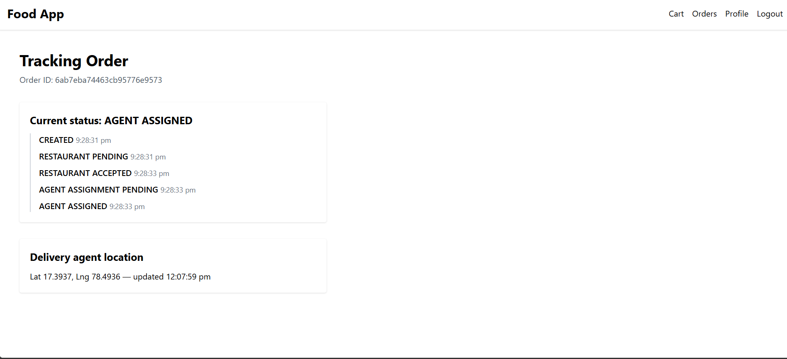
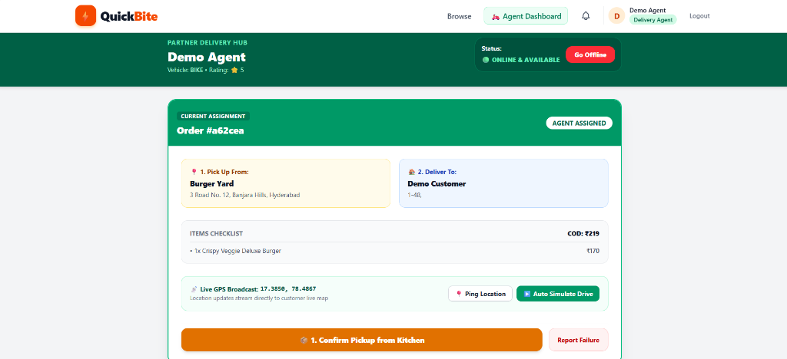
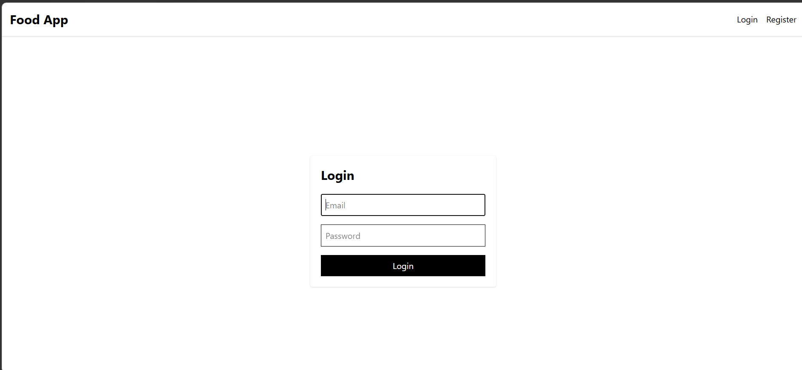

# Food Delivery Microservices Platform

An enterprise-grade, event-driven food ordering and delivery microservices platform built with **Node.js, Express, MongoDB, Redis, Apache Kafka (KRaft), Socket.IO, React 19, Redux Toolkit, and Docker Compose**.

Designed with production architectural patterns: **Choreography-based Saga** with compensating actions, **Transactional Outbox Pattern** for reliable Kafka publishing, **Idempotent Consumers**, **Dead-Letter Queues (DLQ)**, **Redis GEO** with atomic Lua nearest-agent reservation, and full **Multi-Role Frontend Portals** (Customer, Restaurant Staff, Delivery Agent, and Admin).

---

## Application Showcase & Screenshots

### Customer Ordering Experience
| Kitchen Discovery (Home) | Digital Menu & Veg/Non-Veg Filters |
|---|---|
|  |  |

| Checkout, Address & COD Breakdown | Live Order GPS Tracking |
|---|---|
|  |  |

---

### Multi-Role Operations & Fleet Portals
| Restaurant Partner Portal (`/restaurant/dashboard`) | Delivery Partner Hub (`/agent/dashboard`) |
|---|---|
|  |  |

| Admin Command Center (`/admin/dashboard`) | Secure Role-Based Authentication (`/login`) |
|---|---|
|  |  |

---

## System Architecture

```
                                  +-------------------+
                                  |    React Client   |
                                  | (Vite + Redux +   |
                                  |  Tailwind + WS)   |
                                  +---------+---------+
                                            |
                                 HTTP / WS (Port 8080)
                                            v
                                  +-------------------+
                                  |    API Gateway    |
                                  | (Reverse Proxy,   |
                                  |  JWT Auth, Rate   |
                                  |  Limit, Socket.IO)|
                                  +---------+---------+
                                            |
         +-----------------+----------------+-----------------+-----------------+
         |                 |                |                 |                 |
         v                 v                v                 v                 v
   +------------+   +--------------+  +------------+   +--------------+   +-------------+
   |    User    |   |  Restaurant  |  |   Order    |   | Delivery     |   |Notification |
   |  Service   |   |   Service    |  |  Service   |   |Agent Service |   |   Service   |
   +-----+------+   +------+-------+  +-----+------+   +------+-------+   +------+------+
         |                 |                |                 |                  |
         | (MongoDB)       | (MongoDB/Redis)| (MongoDB)       | (Redis GEO/Lua)  | (MongoDB/Redis)
         v                 v                v                 v                  v
    [Users DB]       [Restaurant DB]   [Orders DB]       [Redis Cluster]    [Notifications]
                                            |                 ^                  ^
                                       (Outbox Relay)         |                  |
                                            v                 |                  |
                             +--------------------------------+------------------+
                             |              Apache Kafka (KRaft Mode)             |
                             |  order-created, restaurant-accepted, agent-assign  |
                             |  order-preparing, order-ready, live-tracking, dlq  |
                             +----------------------------------------------------+
```

---

## Microservices Breakdown

| Service | Port (Internal) | Responsibilities & Tech Stack |
|---|---|---|
| **API Gateway** | `8080` (Host) | Single reverse-proxy entry point. JWT authentication & role authorization. Redis-backed rate limiting (10 req/min for auth, 100 req/min general). Socket.IO server bridging Redis Pub/Sub channels to client WebSocket rooms (`user:<id>` and `restaurant:<id>`). |
| **User Service** | `5001` | User registration, bcrypt password hashing, JWT issuing. Profile retrieval and updates. Role-based access control (`customer`, `restaurant`, `agent`, `admin`). Admin user management and role delegation. |
| **Restaurant Service** | `5002` | Restaurant profiles, cuisine indexing, delivery times, cost-for-two, ratings. Menu CRUD with categories, prices, veg/non-veg tags, and photos. Real-time Redis pub/sub dispatch to restaurant owners. |
| **Order Service** | `5003` | Order creation with server-side pricing calculation, address verification, and delivery fees. Explicit state machine engine. Order idempotency. MongoDB Transactional Outbox pattern with background Kafka relay. Restaurant manual decision handling. |
| **Agent Service** | `5004` | Agent onboarding and availability status. Real-time GPS coordinate ingestion. Redis GEO spatial indexing. Atomic nearest-agent reservation via Redis Lua script with self-expiring TTL lease. Live tracking publisher. |
| **Notification Service** | `5005` | MongoDB notification storage, unread tracking, read-all batching. Kafka consumer for all order lifecycle events. Real-time notification dispatch over Redis Pub/Sub to Gateway WebSockets. |
| **Frontend Web App** | `5173` (Host) | React 19, Redux Toolkit, React Router v7, Tailwind CSS, Lucide icons, Socket.IO client. Dedicated dashboards for Customers, Restaurants, Delivery Agents, and Administrators. |

---

## Order State Machine & Saga Flow

```
[Customer]
    |
    v (POST /api/orders)
CREATED / RESTAURANT_PENDING ───────────┐
    |                                   | (Restaurant Rejects)
    v (Restaurant Manual Decision)      v
RESTAURANT_ACCEPTED                 CANCELLED (Compensating action,
    |                                          frees agent if reserved)
    v (PUT /:id/restaurant-status)
PREPARING
    |
    v (PUT /:id/restaurant-status)
READY_FOR_PICKUP
    |
    +───────────────────────────────────┐
    v (Kafka: restaurant-accepted)      |
AGENT_ASSIGNMENT_PENDING                | (No agent nearby)
    |                                   v
    v (Redis Lua atomic reservation)  CANCELLED
AGENT_ASSIGNED
    |
    v (Agent updates status)
PICKED_UP
    |
    v (Agent transmits live GPS coordinates)
OUT_FOR_DELIVERY ───> [Live Socket.IO GPS Tracking Room]
    |
    +───────────────────────────────────┐
    v (Agent confirms delivery)         v (Delivery issues)
DELIVERED                           DELIVERY_FAILED
    |                                   |
    └──────────────┬────────────────────┘
                   v
          [Agent Auto-Released]
```

### Race-Condition Prevention
Every order status transition is validated against a strict state machine table (`src/stateMachine.js`) and committed using atomic conditional MongoDB updates (`findOneAndUpdate({ _id, status: currentStatus }, ...)`). If concurrent requests attempt conflicting transitions (e.g., customer cancels while restaurant accepts), only one succeeds; the second receives a `409 Conflict`.

---

## Reliability Patterns

1. **Transactional Outbox Pattern**:
   Order mutations and their corresponding event records are committed in the same database transaction/update. A resilient background polling relay publishes pending events to Kafka and updates their outbox status to `SENT`. If Kafka is temporarily unreachable, outbox events remain pending with exponential backoff retries.
2. **Idempotent Consumers**:
   Every consumer tracks processed message IDs in Redis/database before executing side-effects. Duplicate delivery from Kafka rebalances does not cause duplicate business processing.
3. **Dead-Letter Queues (DLQ)**:
   Any event failing processing after 3 exponential backoff retries is redirected to `<topic-name>.dlq` with stack traces and metadata for inspection.
4. **Atomic Agent Reservation with Lease**:
   A Redis Lua script queries `GEORADIUS` around the restaurant location and acquires a mutex lease on the nearest online agent in a single atomic transaction. The lease auto-expires (TTL: 2 hours) if an agent goes abruptly offline, preventing zombie locks.
5. **Idempotent Order Creation**:
   `POST /api/orders` supports an `idempotencyKey` header or body parameter. Duplicate form submissions or network retries return the existing order without duplicate charges or database rows.

---

## Multi-Role Portals & Dashboards

### 1. Customer Ordering Portal

- **Kitchen Discovery**: Browse curated restaurants with real-time search and filter chips (All Cuisines, Indian, Italian, Chinese, American).
- **Interactive Menu**: View dishes categorized by section, inspect Veg/Non-Veg indicators, view pricing, ratings, and add to cart with real-time Redux state synchronization.

- **Checkout & Review**: Configure delivery address, add cooking instructions, inspect subtotal and delivery charges, and place order via Cash on Delivery (COD).

- **Live Order Tracking**: Visual milestone progress, driver vehicle info, and streaming GPS map coordinates via WebSockets.
- **In-App Notifications**: Real-time bell modal with live updates and unread counts.

---

### 2. Restaurant Partner Portal (`/restaurant/dashboard`)

- **Real-Time Incoming Queue**: Incoming orders stream directly to the kitchen via Redis Pub/Sub and Socket.IO rooms (`restaurant:<id>`).
- **Kitchen Inspection**: View customer details, contact number, ordered dishes, special instructions, and total bill.
- **Manual Decision Flow**:
  - **Accept & Start Prep**: Staff specifies preparation time (e.g., 25 mins), moving order to `RESTAURANT_ACCEPTED` and kicking off agent assignment.
  - **Decline Order**: Staff provides rejection reason, cleanly terminating the saga and alerting the customer.
- **Kitchen Controls**: Advance preparation status from `PREPARING` to `READY_FOR_PICKUP`.
- **Operating Status**: Toggle kitchen availability (`Accepting Orders (OPEN)` / `Temporarily Closed`).

---

### 3. Delivery Partner Hub (`/agent/dashboard`)

- **Duty Toggle**: Toggle online/offline status with instant Redis GEO synchronization.
- **Active Assignment Card**: Shows restaurant pickup address, customer destination, and contact numbers.
- **Live GPS Simulator**: One-click coordinate updates (`Ping Location` and `Auto Simulate Drive`) broadcasting live latitude/longitude pings to customer tracking rooms via Redis Pub/Sub.
- **Delivery Milestones**:
  - `Confirm Pickup from Kitchen` → Moves status to `PICKED_UP`.
  - `Start Delivery (Out for Delivery)` → Moves status to `OUT_FOR_DELIVERY`.
  - `Confirm Delivery` → Moves status to `DELIVERED` and releases agent reservation.
  - `Report Failure` → Triggers compensating cancellation workflow.

---

### 4. Admin Command Center (`/admin/dashboard`)

- **System Metrics**: Total Orders, Registered Restaurants, Active Delivery Agents, and Total Platform Users.
- **Service Mesh Health**: Real-time status indicators for API Gateway, Redis & GEO Engine, and Kafka (KRaft) Cluster.
- **Live Order Stream**: Audit all orders flowing through the platform with live status badges.
- **Role Management**: Inspect registered users and promote/demote roles between `customer`, `restaurant`, `agent`, and `admin`.

---

## Quick Start (Docker Compose)

### 1. Clone & Configure Environment

```bash
git clone https://github.com/BhaskarManikanta/FoodDelivery.git
cd FoodDelivery
cp .env.example .env
```

Ensure `.env` contains valid secrets:
```env
JWT_SECRET=super_secure_jwt_secret_key_32_characters_minimum
INTERNAL_SERVICE_SECRET=internal_communication_secret_key_prod
```

### 2. Start Services via Docker Compose

```bash
docker compose up --build -d
```

### 3. Seed Demo Data (Multi-Role Accounts & Restaurants)

```bash
node scripts/seed-all.js
```

### 4. Access URLs

| Application / Service | URL | Notes |
|---|---|---|
| **Frontend Web App** | [http://localhost:5173](http://localhost:5173) | Responsive Multi-Role UI |
| **API Gateway** | [http://localhost:8080](http://localhost:8080) | Public API Entrypoint |
| **Kafka UI** | [http://localhost:8081](http://localhost:8081) | KRaft broker topics & DLQ viewer |

### 5. Demo Credentials

Quick-fill buttons are provided on the `/login` page:

| Role | Email | Password | Access / Dashboard |
|---|---|---|---|
| **Customer** | `customer@example.com` | `password123` | Browsing, Cart, Orders, Live Tracking |
| **Restaurant Staff** | `restaurant@example.com` | `password123` | `/restaurant/dashboard` (Kitchen Orders) |
| **Delivery Agent** | `agent@example.com` | `password123` | `/agent/dashboard` (GPS & Deliveries) |
| **System Admin** | `admin@example.com` | `password123` | `/admin/dashboard` (Global Analytics & Users) |

---

## Kafka Event Catalog

| Topic Name | Producer Service | Consumer Services | Purpose |
|---|---|---|---|
| `order-created` | Order Service (Outbox) | Restaurant Service, Notification Service | Initiates order saga; notifies restaurant kitchen |
| `restaurant-accepted` | Order Service (Outbox) | Agent Service, Notification Service | Kitchen accepted order; triggers nearest agent search |
| `restaurant-rejected` | Order Service (Outbox) | Notification Service | Kitchen rejected order; cancels saga |
| `order-preparing` | Order Service (Outbox) | Notification Service | Kitchen started cooking |
| `order-ready-for-pickup`| Order Service (Outbox) | Notification Service | Food packed and waiting for driver |
| `agent-assigned` | Agent Service | Order Service, Notification Service | Delivery partner matched and reserved |
| `no-agent-available` | Agent Service | Order Service, Notification Service | No drivers nearby; cancels order |
| `order-picked-up` | Order Service (Outbox) | Notification Service | Agent collected parcel from kitchen |
| `out-for-delivery` | Order Service (Outbox) | Notification Service | Agent en route to customer destination |
| `order-delivered` | Order Service (Outbox) | Notification Service, Agent Service | Delivery successful; releases agent |
| `delivery-failed` | Order Service (Outbox) | Notification Service, Agent Service | Delivery failed; releases agent |
| `order-cancelled` | Order Service (Outbox) | Notification Service, Agent Service | Order cancelled; releases agent |

Every topic has an automatic dead-letter counterpart: `<topic>.dlq`.

---

## Automated Test Suites

All microservices include automated tests using Node.js native test runner (`node:test`).

```bash
# User Service (5 tests)
npm --prefix services/user-service test

# Order Service (20 tests: state machine, outbox, pricing, restaurant decisions)
npm --prefix services/order-service test

# Restaurant Service (6 tests: schema validation, geo bounds, menu items)
npm --prefix services/restaurant-service test

# Notification Service (3 tests: model schema, read flags, indexing)
npm --prefix services/notification-service test

# Frontend Production Build (Vite + Rolldown)
npm --prefix frontend run build
```

**Total Verified**: 34 automated backend unit tests passing with zero failures. Frontend production bundle compiles cleanly.

---

## Complete API Reference

All requests route through Gateway (`http://localhost:8080`).

### Authentication & Users (`/api/users`)
- `POST /register`: Register customer account
- `POST /register-staff`: Internal endpoint (requires `x-internal-secret`) to onboard staff & agents
- `POST /login`: Authenticate and obtain JWT
- `GET /profile`: Get authenticated user profile
- `PUT /profile`: Update name, phone, address
- `GET /admin/all`: Paginated user list with role filters *(Admin only)*
- `PATCH /admin/:id/role`: Update user role *(Admin only)*
- `GET /admin/stats`: Get registered user counts by role *(Admin only)*

### Restaurants (`/api/restaurants`)
- `GET /`: Get all restaurants with cuisine & isOpen filtering
- `GET /search?q=`: Full-text search for restaurants
- `GET /:id`: Get restaurant details and full categorized menu
- `GET /mine`: Get authenticated restaurant owner's kitchen
- `POST /`: Create restaurant profile *(Restaurant / Admin)*
- `PATCH /:id`: Update restaurant profile *(Owner / Admin)*
- `POST /:restaurantId/menu`: Add menu item *(Owner / Admin)*
- `PATCH /:restaurantId/menu/:itemId`: Update menu item *(Owner / Admin)*
- `DELETE /:restaurantId/menu/:itemId`: Delete menu item *(Owner / Admin)*

### Orders (`/api/orders`)
- `POST /`: Create order with server-computed prices & idempotency key
- `GET /my-orders`: Get customer order history
- `GET /restaurant/mine`: Get orders for authenticated restaurant
- `GET /agent/mine`: Get delivery assignments for authenticated agent
- `GET /admin/all`: Global order audit feed *(Admin only)*
- `GET /:id`: Get detailed order breakdown (scoped by ownership)
- `POST /:id/restaurant-decision`: Accept or reject incoming order *(Restaurant / Admin)*
- `PUT /:id/restaurant-status`: Advance order to `PREPARING` or `READY_FOR_PICKUP` *(Restaurant / Admin)*
- `PATCH /:id/status`: Update status (`PICKED_UP`, `OUT_FOR_DELIVERY`, `DELIVERED`, `DELIVERY_FAILED`) *(Assigned Agent only)*
- `PATCH /:id/cancel`: Cancel order while in cancellable window *(Customer only)*

### Delivery Agents (`/api/agents`)
- `GET /status/me`: Get current agent online/offline status and active assignments
- `PATCH /status`: Toggle agent online/offline status
- `PATCH /location`: Transmit GPS coordinates (`lat`, `lng`), update Redis GEO, and stream to live tracking
- `GET /details/:agentId`: Get public driver profile (name, vehicle, rating)
- `GET /all`: Admin driver audit *(Admin only)*

### Notifications (`/api/notifications`)
- `GET /`: Get paginated notification history for authenticated user
- `PATCH /read-all`: Mark all notifications as read
- `PATCH /:id/read`: Mark single notification as read

---

## Author & License

Designed and engineered for high-availability distributed systems demonstration.  
**Bhaskar Manikanta**: [GitHub](https://github.com/BhaskarManikanta)
